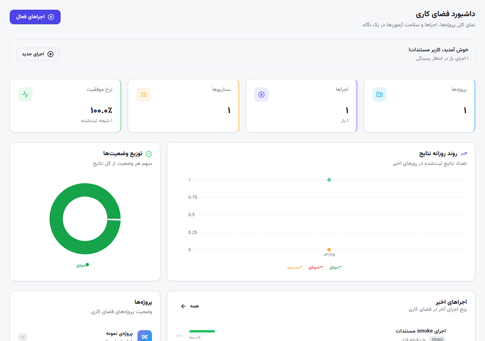
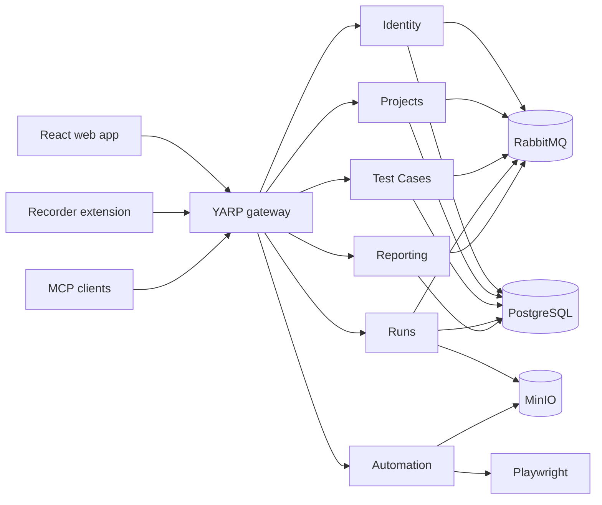

# Azma

Azma is a Persian-first, RTL test-management and browser-automation platform built with .NET 8 microservices and React/TypeScript.

> آزمـا یک پلتفرم فارسی مدیریت تست، اجرای سناریوهای خودکار و گزارش‌گیری تیمی است.



## Highlights

- Manage workspaces, projects, suites, sections, test cases, runs, results, comments, attachments, and custom fields.
- Record browser scenarios with the Chrome/Firefox extension and replay them through Playwright.
- Schedule and distribute automated runs with PostgreSQL row locking and background workers.
- Keep reporting read models synchronized through RabbitMQ and MassTransit consumers.
- Enforce workspace- and project-scoped authorization with JWT authentication.
- Access projects, test cases, runs, schedules, reports, and memberships through an MCP endpoint.
- Serve a responsive Persian/RTL interface with Jalali date support.

## Architecture



### Technology

| Area | Technology |
| --- | --- |
| Backend | .NET 8, ASP.NET Core, EF Core, MediatR, FluentValidation |
| Frontend | React 18, TypeScript, Vite, Tailwind CSS, shadcn/ui |
| Data | PostgreSQL, Redis, MinIO |
| Messaging | RabbitMQ, MassTransit, retry policies |
| Gateway/API | YARP, REST, MCP |
| Automation | Playwright, Chrome/Firefox recorder extension |
| Observability | Serilog, Seq, OpenTelemetry |
| Testing | xUnit, FluentAssertions, property tests, Testcontainers |

## Repository layout

```text
src/
├── BuildingBlocks/       Shared auth, storage, event bus, automation, and common primitives
├── Gateway/              YARP gateway and MCP endpoint
├── Services/
│   ├── Automation/       Playwright scenario recording and replay
│   ├── Identity/         Users, workspaces, memberships, JWT, MCP tokens
│   ├── Projects/         Projects, milestones, suites, members
│   ├── Reporting/        Event-driven reporting read models
│   ├── Runs/             Manual, scheduled, and automated test runs
│   └── TestCases/        Repository, cases, steps, tags, and versions
└── Web/
    ├── azma-web/         React SPA
    └── azma-recorder-extension/
tests/                    Unit, property, integration, and Testcontainers tests
deploy/                   Docker Compose development infrastructure
```

## Local development

### Prerequisites

- .NET SDK 8.0.406 or a compatible 8.0 SDK
- Node.js 22.13 or newer
- Docker Desktop or Docker Engine with Compose
- PowerShell 7 is recommended for the helper scripts

### Windows quick start

```powershell
npm ci --prefix src/Web/azma-web
./scripts/start-azma.ps1
```

The starter launches the infrastructure, builds the solution and recorder extension, installs Playwright Chromium, and starts all services.

### Manual setup

```powershell
docker compose -f deploy/docker-compose.yml up -d

dotnet restore Azma.sln
dotnet build Azma.sln

npm ci --prefix src/Web/azma-web
npm run build --prefix src/Web/azma-recorder-extension
npm run dev --prefix src/Web/azma-web
```

Start the gateway and service projects from `src/Gateway` and `src/Services` in separate terminals, or use the helper script above.

### Local endpoints

| Service | URL |
| --- | --- |
| Web | <http://localhost:5173> |
| Gateway | <http://localhost:8080> |
| MCP | <http://localhost:8080/mcp> |
| Identity | <http://localhost:5201> |
| Projects | <http://localhost:5202> |
| Test Cases | <http://localhost:5203> |
| Runs | <http://localhost:5204> |
| Reporting | <http://localhost:5205> |
| Automation | <http://localhost:5206> |
| RabbitMQ management | <http://localhost:15672> |
| MinIO console | <http://localhost:9001> |
| PostgreSQL | `localhost:5560` |
| Redis | `localhost:6379` |

## Verification

```powershell
dotnet test Azma.sln --configuration Release

npm run lint --prefix src/Web/azma-web
npm run build --prefix src/Web/azma-web
npm run build --prefix src/Web/azma-recorder-extension
```

The Runs integration tests use Testcontainers and therefore require a working Docker daemon.

## Configuration and secrets

Values committed in `appsettings.json` and `deploy/docker-compose.yml` are development-only defaults. Do not reuse them in a deployed environment. ASP.NET Core configuration can be overridden with environment variables using double underscores, for example:

```text
ConnectionStrings__Postgres=...
Jwt__SigningKey=...
RabbitMq__Password=...
Storage__SecretKey=...
```

Keep production credentials in a secret manager or deployment environment, never in this repository.

## Additional screenshots

- [Test repository](src/Web/azma-web/public/docs/screenshots/docs-repository-tree.png)
- [Scheduled runs](src/Web/azma-web/public/docs/screenshots/docs-run-schedules.png)
- [Reports](src/Web/azma-web/public/docs/screenshots/docs-reports.png)

## License

Licensed under the [MIT License](LICENSE).
